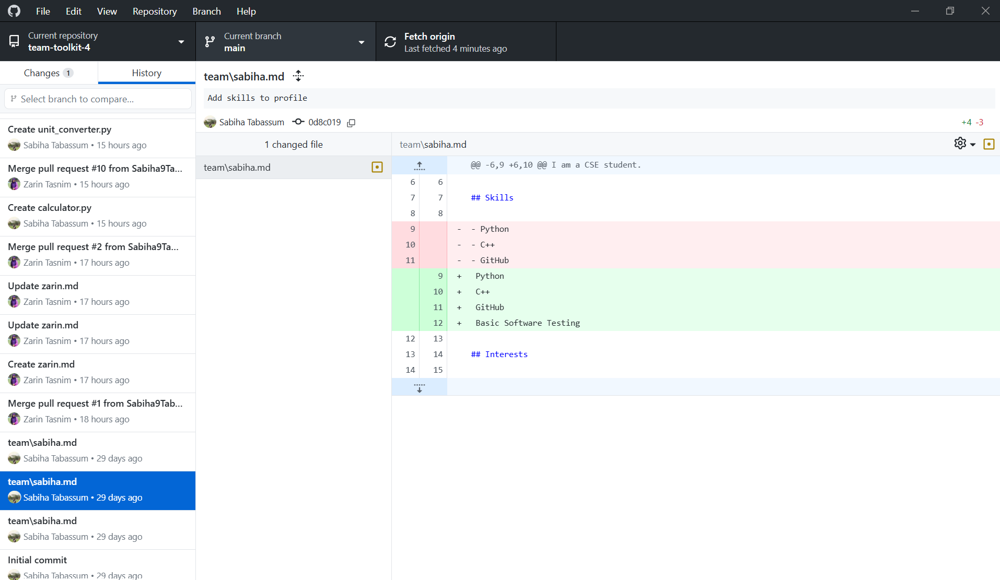
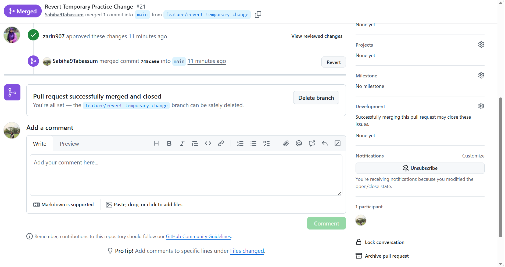
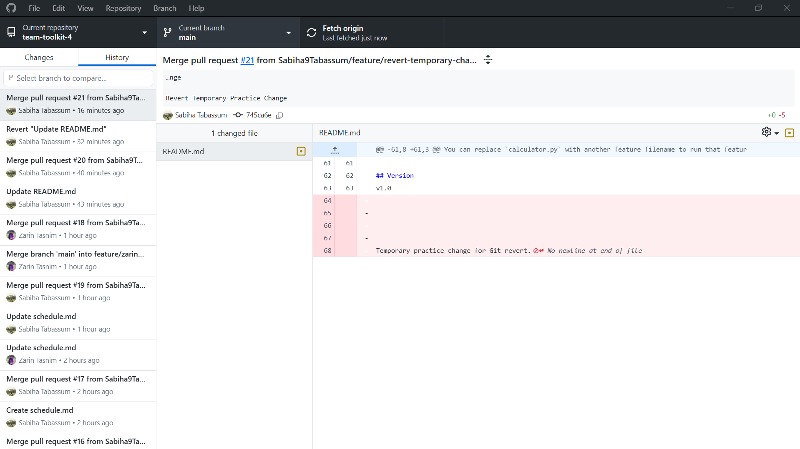
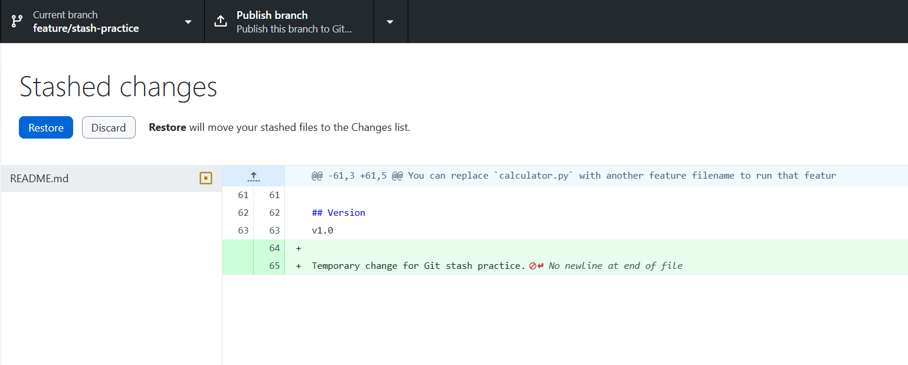
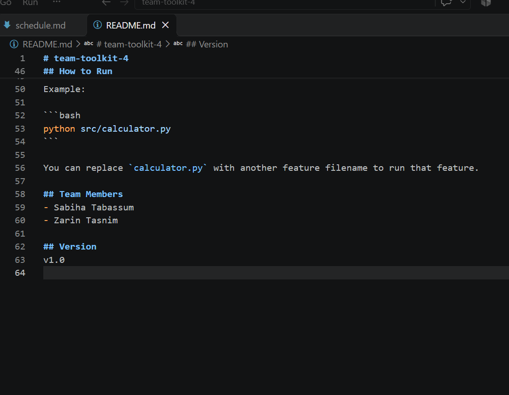
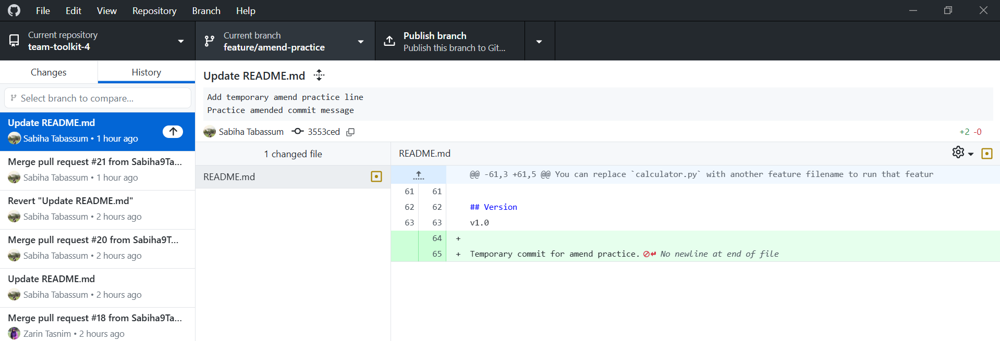
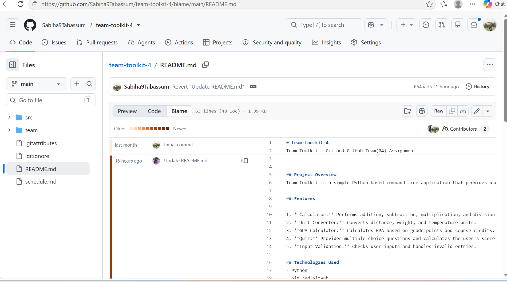
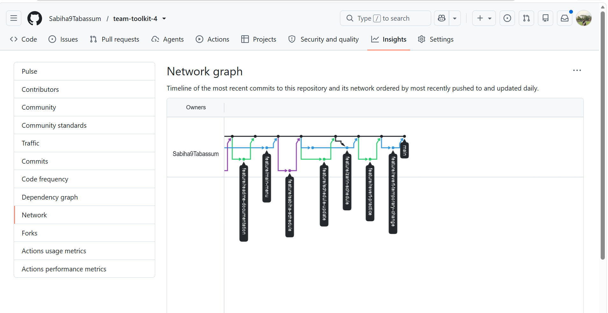
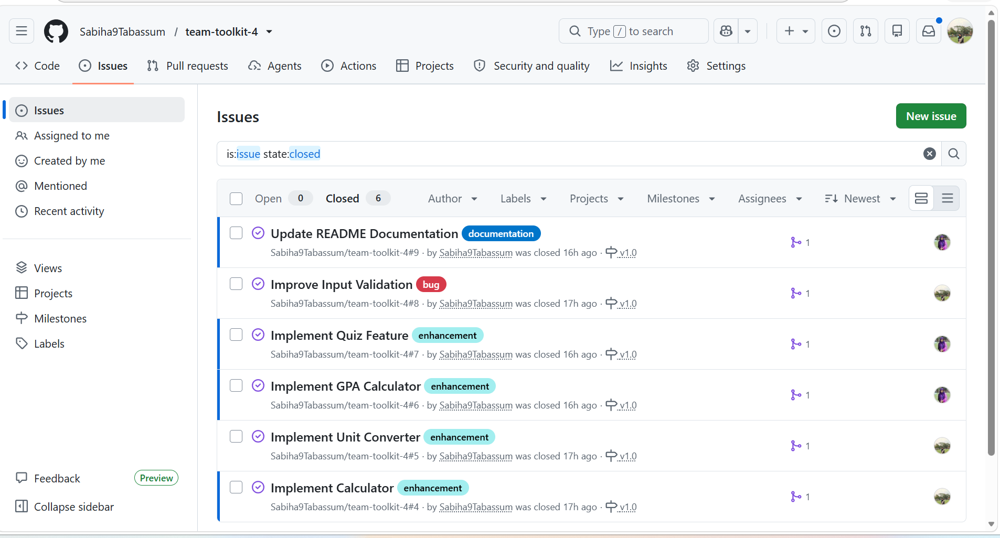
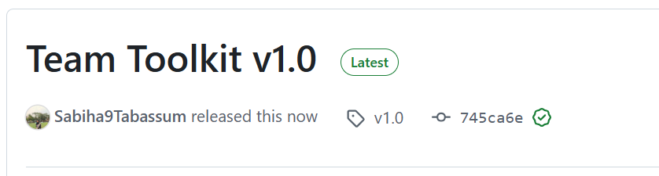

# Team Toolkit – Project Report

## 1. Project Information

- **Project Name:** Team Toolkit
- **Repository:** team-toolkit-4
- **Release Version:** v1.0
- **Language:** Python
- **Team Members:** Sabiha Tabassum and Zarin Tasnim

## 2. Project Overview

Team Toolkit is a menu-driven Python application developed as a team project. It provides several useful tools through a simple command-line interface.

## 3. Implemented Features

1. Calculator
2. Unit Converter
3. GPA Calculator
4. Quiz
5. Input Validation Demo

## 4. Merge Conflict Resolution

During the merge conflict exercise, two branches modified the same line in `schedule.md`.

- One branch changed the meeting time to Tuesday at 10:00 PM.
- Another branch changed it to Wednesday at 8:00 PM.
- Git detected a conflict because both branches modified the same line.
- We opened the conflicted file in VS Code.
- We resolved the conflict by keeping Tuesday at 10:00 PM and removing the conflict markers.
- We saved the file, completed the merge, pushed the changes, and merged the Pull Request.

## 5. Advanced Git Operations

The following Git operations were demonstrated:

1. Viewing commit differences.
2. Reverting a commit using a Pull Request.
3. Stashing changes, switching branches, and restoring changes.
4. Amending an unpushed commit.
5. Using Git Blame to identify line authors and commits.
6. Viewing the branch network graph.

### 6. Screenshots and Evidence

All screenshots are stored in the `screenshots` folder.

### 6.1 Commit Diff

### 6.2 Temporary Change Pull Request

### 6.3 Revert Pull Request

### 6.4 Git Stash

### 6.5 Amended Commit

### 6.6 Git Blame

### 6.7 Network Graph

### 6.8 Closed Issues

### 6.9 Final Release

## 7. Final Release

The project was published as **Team Toolkit v1.0** on GitHub.

All six v1.0 milestone issues were closed, and the final release was created using the `v1.0` tag.

## 8. Conclusion

This project provided practical experience with Python development, Git branching, Pull Requests, code reviews, merge conflict resolution, and GitHub releases.